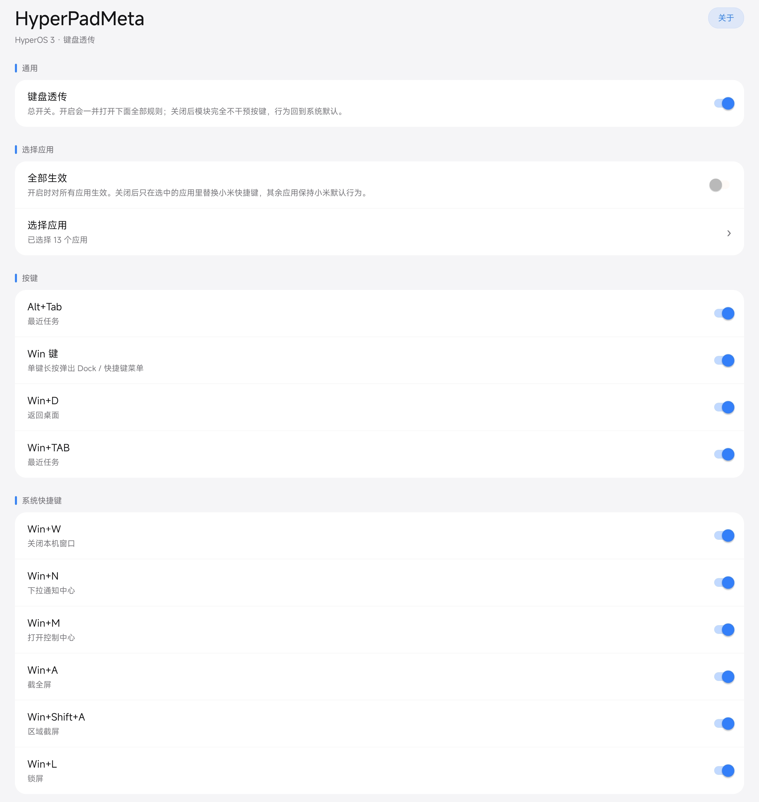
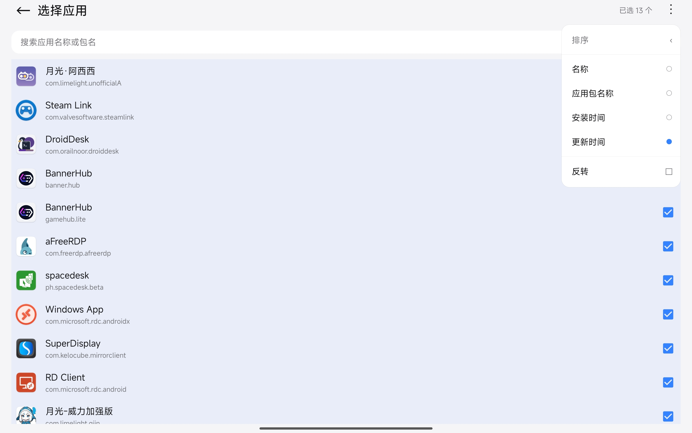

# HyperPadMeta

在 **HyperOS 3 / Android 16** 上恢复键盘 Meta/Win 键，把 `Alt+Tab`、`Win`、`Win+D`、`Win+TAB` 透传给远程桌面：屏蔽系统的最近任务与「显示桌面」响应，同时避免关掉系统快捷键后被吞键。实测设备：小米平板 6S Pro（OS3.0.304.0.WNXCNXM）。

> **适配范围：只支持 HyperOS 3 / Android 16。** 本仓库是 [CwithW/MiuiPadMeta](https://github.com/CwithW/MiuiPadMeta) 的 fork，上游面向 MIUI / Android 11–13；fork 把包名（`pub.chara.miuipadmeta` → `pub.chara.hyperpadmeta`）和按键适配代码都改成了 HyperOS 3 的链路，**应不适配 MIUI 及 Android 15 以下版本**，旧系统请继续用原 MiuiPadMeta。

### 系统版本支持情况 OS version support

| 系统版本                    | 恢复Meta键     | 禁用Alt-Tab   |
| ----------------------- | ----------- | ----------- |
| HyperOS（1/2，未测）         | √? **** | √? **** |
| **HyperOS 3 Android16** | **√**       | **√**       |
| 非MIUI系统                 | N/A         | ? ***    |

√ 表示经过测试，目前支持

? 表示没有经过测试，可能支持

× 表示经过测试，目前不支持

> 禁用Alt-Tab理论上在所有Android系统上支持。
>
> **HyperOS 3 / Android 16 已在小米平板6S Pro（OS3.0.304.0.WNXCNXM）上实测通过**。

#### 实机测试记录：

小米平板6S Pro HyperOS 3.0 OS3.0.304.0.WNXCNXM Android16

### 安装 Installation

1. 设备需已 root 并安装 **LSPosed**（或其他支持模块的 Xposed 框架）；
2. 安装 [Release](https://github.com/liuqianhe/HyperPadMeta/releases) 里的 APK，在 LSPosed 管理器里启用模块，**作用域勾选「系统」（`android`）**；
3. 重启一次设备（首次启用必须重启才注入 `system_server`）；
4. 桌面出现「HyperPadMeta」图标即可打开设置页调开关 —— **之后改开关不用再重启**。

> 从旧包名 `pub.chara.miuipadmeta`升级时请把旧模块在 LSPosed 里停用，两者同时启用会重复 hook。

### 已知冲突 Known conflicts

**Xposed Edge ProMax（`com.jozein.xedgepro`）**：开启它的「按键」功能后会自己注册一遍按键监听，与本模块抢事件 ——
用本模块时请在 Xposed Edge ProMax 里关掉「按键」，或直接在 LSPosed 里停用该模块。

### 鸣谢 Special thanks

本模块借鉴了 [MiuiPadESC](https://github.com/YifePlayte/MiuiPadESC) 的框架代码。

[MiuiPadESC](https://modules.lsposed.org/module/com.yifeplayte.miuipadesc) 用来恢复 ESC（本模块不管 ESC）。上游时代它还要负责禁用 Win+D，本 fork 已经自己接管了 Win+D，不需要再靠它。

[MaxMiPadInput](https://modules.lsposed.org/module/com.yifeplayte.maxmipadinput) MIUI14 下 MiuiPadESC失效 需要用这个模块恢复ESC

### 实现方法 Implementation detail

#### Android11

1. 让`com.android.server.policy.MiuiKeyShortcutManager.getEnableKsFeature`固定返回false，MIUI的快捷键就不会使能
   （或：`setprop persist.sys.enable_custom_shortcut_user 0`）

   实现方法：hook `com.android.server.policy.MiuiKeyShortcutManager.getEnableKsFeature` 固定返回false

2. 让`com.android.server.policy.PhoneWindowManager.interceptKeyBeforeDispatching` 不拦截meta key 就是包名为com.ss.android.lark.kami时的效果（MIUI给自家app开后门，只有自家app运行时不拦截meta key 其他app都拦截）

   实现方法：自定义类重写List的contains方法 替换掉`static List<String> sDeliveMetaKeyAppList`

3. 修改逻辑禁用安卓自带的alt-tab

   实现方法：hook `com.android.server.policy.PhoneWindowManager.interceptKeyBeforeDispatching` 如果是Alt-Tab则不继续运行

#### Android12

1. 同Android11 （但是这个类不在services.jar里在miui-services.jar里）

   (内部实现从setprop变成了`settings put system is_custom_shortcut_effective 0`)

2. 存在`com.android.server.policy.PhoneWindowManagerStubImpl.DELIVE_META_APPS` 被`com.android.server.policy.PhoneWindowManagerStubImpl.interceptKeyWithMeta()`使用 但是这个函数P用没有

   所以和alt-tab的实现方法一样：直接hook `com.android.server.policy.PhoneWindowManager.interceptKeyBeforeDispatching` 如果有按下meta键就直接返回0不拦截 简单粗暴

3. 同Android11

#### Android13

同 Android12，不需要单独适配。

#### HyperOS 3

HyperOS 3 上这些组合由 `MiuiKeyShortcutRuleManager` 注册成 `KeyboardCombinationRule`，再交给 AOSP 的 `KeyCombinationManager` 判定是否消费。

在 HyperOS 3 上，Alt-Tab 与 Win 键都被小米自己的 `BaseMiuiPhoneWindowManager` 子类 / 快捷键规则系统在更早阶段接管：

**Alt+Tab：**

- `BaseMiuiPhoneWindowManager.interceptKeyBeforeDispatching(IBinder, KeyEvent, int)` 重写了 AOSP 父类，内部调用私有的 `handleAltTab(KeyEvent)` 通知系统弹最近任务，但**不消费按键**（系统与远程桌面同时响应 → 双响应）；
- 关闭「设置 → 手写笔与键盘 → 键盘 → 自定义快捷键 → ALT TAB」开关时，该键在小米这层被直接吞掉（远程收不到）。

**Win 键（Win+D / Win+TAB / Win+方向等）：**

- 这些组合由 `MiuiKeyShortcutRuleManager` 注册为 `KeyboardCombinationRule`（继承 `KeyCombinationManager$TwoKeysCombinationRule`），交给 `KeyCombinationManager` 判定；
- `KeyboardCombinationRule.shouldInterceptKeys()` 只按 primaryKey + metaState 精确匹配就返回 true 拦截，**不看快捷键是否 enable** —— 无论「Win D / Win TAB」开关开/关，带 meta 的按键都会被消费/吞掉；
- 旧模块用来禁用整套小米快捷键的 `MiuiKeyShortcutManager` 类已被删除，原 hook 整体失效。

适配方式（见 `hook/HyperOSAltTabHooks.kt`，SDK ≥ 35 时由 `MainHook` 装载）：对以下方法做 before hook，命中设置页开关的 Alt+Tab 与带 Win 修饰（`META_META_ON`）的事件短路放行，让按键只交给前台/远程桌面；开关关闭时完全不干预：

1. `BaseMiuiPhoneWindowManager.interceptKeyBeforeDispatching` → `param.result = 0L`（Alt+Tab / Meta 键 / Win 组合，按对应开关）
2. AOSP `PhoneWindowManager.interceptKeyBeforeDispatching` → `param.result = 0L`
3. `BaseMiuiPhoneWindowManager.handleAltTab(KeyEvent)` → `param.result = null`（按事件命中：`Alt+TAB` 看「Alt+Tab」开关，`Win+TAB` 看「Win+TAB」开关）
4. `BaseMiuiPhoneWindowManager.handleMetaKey(KeyEvent)` → `param.result = null`（受「Win 键」开关控制，单按 Win 不弹 Dock）
5. `KeyboardCombinationRule.shouldInterceptKeys(int, int)` → 命中项返回 `false`（不拦截 Win 组合）
6. `KeyCombinationManager.isKeyConsumed` / `shouldConsumedKey` → 命中项返回 `false`（兜底）
7. `MiuiKeyInterceptExtend.getKeyInterceptType(BeforeQueueing|BeforeDispatching)` → 命中项返回 `1`

第 7 条按「策略类型」判定，这个返回值不是布尔量：

- `0` / `TYPE_INTERCEPT_NULL`：无特殊类型，继续走后续 MIUI 处理链；
- `1` / `TYPE_INTERCEPT_MIUI_AND_AOSP`：直接 `pass the key to app` 并 `return`，目标键取这个值；
- `2` / `TYPE_INTERCEPT_AOSP`：交给 AOSP 父类处理；
- `4` / `TYPE_INTERCEPT_MIUI_AND_AOSP_NO_PASS_TO_USER`：消费掉，不给应用。

命中条件同第 1、3、4 条：单按 `Meta` 看「Win 键」开关，`Alt+TAB` 看「Alt+Tab」开关，
带 `META_META_ON` 的 `Win+D` / `Win+TAB` 看各自开关，其余 Win 组合看总开关；
电源键与音量键不参与。两个两参包装方法可能被内联，因此对四参的
`getKeyInterceptType(INTERCEPT_STAGE, KeyEvent, int, WindowState)` 也做一层兜底 hook。

实测（小米平板6S Pro，HyperOS 3 / Android 16）：

- **Alt+Tab**：开关打开时只交给远程桌面等，系统不弹最近任务、也不吞键；开关关闭时按键交回系统，由系统的「ALT TAB」快捷键逻辑处理；
- **Win+D / Win+TAB / 单按 Win**：开关打开时按键（带 `META_META_ON`）完整派发到前台应用，系统不再"显示桌面"/弹最近任务、也不再吞键；关闭后对应组合立即恢复系统默认行为（例如关掉 Win+D 后按 Win+D 会重新弹「显示桌面」）；
- 用物理键盘逐项验证通过。注意 **adb 注入（`input keycombination` / `sendevent`）触发不了小米的 Win 快捷键链路**，这类改动只能在物理键盘上确认。

### 设置页与开关 Settings

模块带一个设置页，按分组卡片列出各项开关：

| 分组 | 开关      | 默认 | 说明                                               |
| -- | ------- | -- | ------------------------------------------------ |
| 通用 | 键盘透传    | 开  | 总开关。关闭后模块完全不干预按键，行为回到系统默认                        |
| 按键 | Alt+Tab | 开  | 只发给远程桌面，系统不弹最近任务                                 |
| 按键 | Win 键   | 开  | 单按 Win 不弹 Dock / 快捷键菜单                           |
| 按键 | Win+D   | 开  | 不触发系统「显示桌面」                                      |
| 按键 | Win+TAB | 开  | 不触发系统最近任务                                        |
| 界面 | 显示桌面图标  | 开  | 关闭后隐藏桌面图标（切 `activity-alias`，可在「设置 → 应用」里重新打开本页） |

- 总开关关闭时子项自动置灰锁定；打开总开关会一并打开全部子项。
- **改开关不需要重启**：hook 侧 500ms 节流刷新，切换后按一下键即生效。
- 设置值保存在应用自己的 `SharedPreferences("settings")` 里。

### 截图 Screenshot

主页面

白名单选择页面

### 第三方开源引用 Open Source License

#### Apache License 2.0

[KyuubiRan/EzXHelper](https://github.com/KyuubiRan/EzXHelper)
